<div align="center">

# 👁️ SeeUinAI

### See how AI sees your brand

Track how often ChatGPT-style assistants mention and link to your website, turn it into numbers and charts, and get a plan to improve it.


<br>

[](docs/media/demo.mp4)

**▶ [Watch the full walkthrough](docs/media/demo.mp4)** · 2 min · voice-over, music and subtitles ([SRT](docs/media/demo.en.srt))

*The preview above is a 4× time-lapse. Everything in the video is demo data: a fictional brand, a fake AI backend, a stubbed payment.*

</div>

---

## ✨ What is it?

People increasingly ask AI assistants instead of searching Google. **AEO** (Answer Engine Optimization) is the work of getting your brand into those answers.

SeeUinAI asks the model the questions your customers ask, reads the answer, and checks whether **your site is cited** and **at what position**. The result is a dashboard with visibility, average position, per-query scores and a list of competing sources.

- 🔐 **Accounts**: sign up and log in with JWT-protected API.
- 💬 **Guided onboarding**: a short chat finds your brand, suggests commercial phrases and queries.
- 📊 **Overview**: visibility %, average position, per-query score and citations, with a daily history.
- 📧 **Email funnel**: a report right after sign-up, reminders later (for subscribers).
- 💳 **Plans and payment** through Stripe Checkout, plus a contact form for custom plans.
- 🔌 **Three answer sources**: OpenAI API, Google AI Overview (SerpAPI) and the real ChatGPT UI driven by Playwright.

## 🖼️ Screenshots

<table>
<tr>
<td width="50%">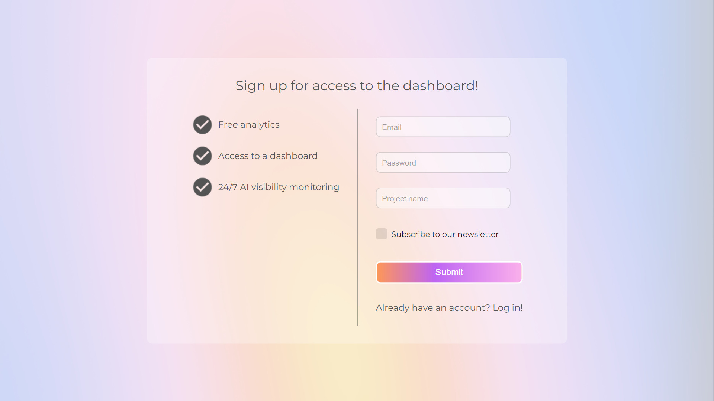<br><sub><b>1 · Sign up</b>: email, password, project name</sub></td>
<td width="50%">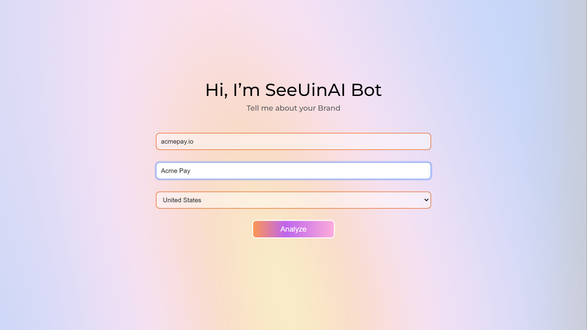<br><sub><b>2 · Brand</b>: website, name, target market</sub></td>
</tr>
<tr>
<td>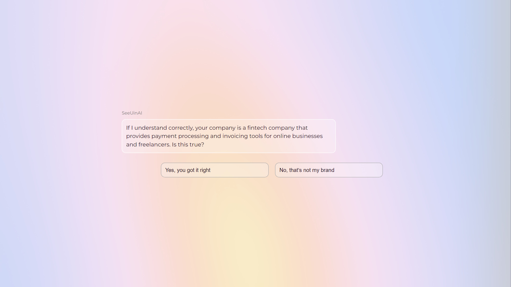<br><sub><b>3 · AI summary</b>: does the model know the company?</sub></td>
<td>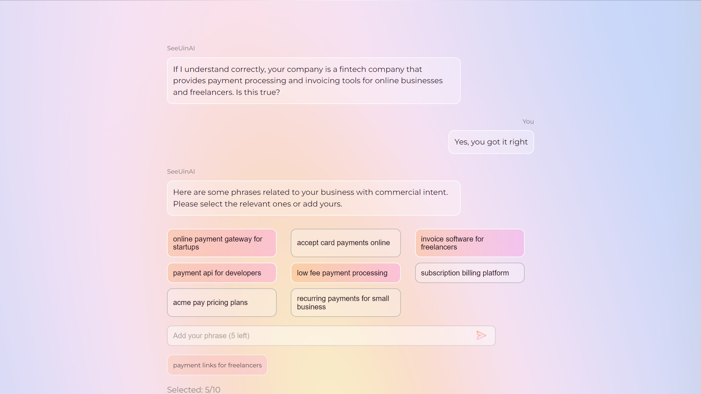<br><sub><b>4 · Phrases</b>: pick commercial phrases or add your own</sub></td>
</tr>
<tr>
<td>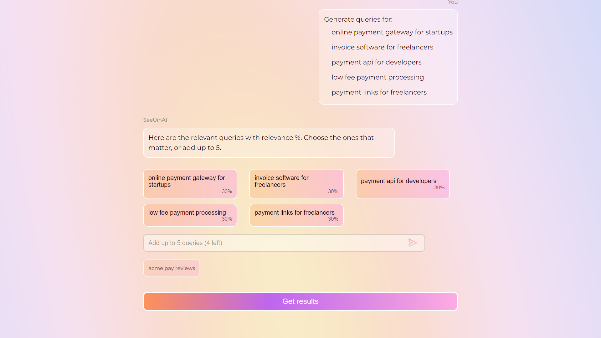<br><sub><b>5 · Queries</b>: relevance score, up to five extra queries</sub></td>
<td>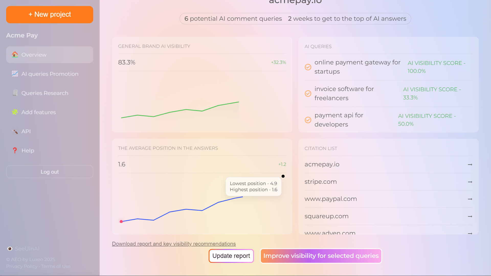<br><sub><b>6 · Overview</b>: visibility, position, scores, sources</sub></td>
</tr>
<tr>
<td>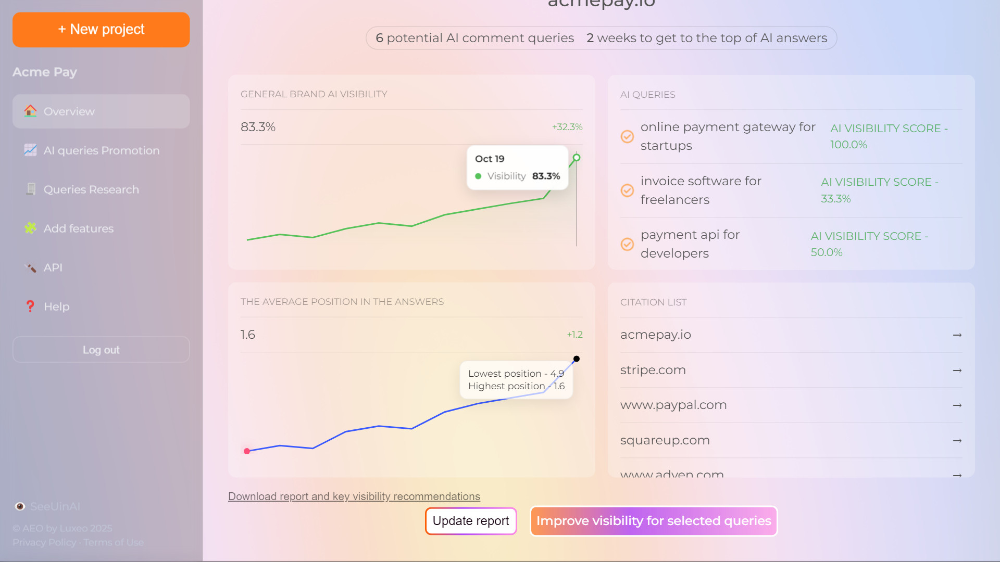<br><sub><b>7 · History</b>: one point per day, hover for details</sub></td>
<td>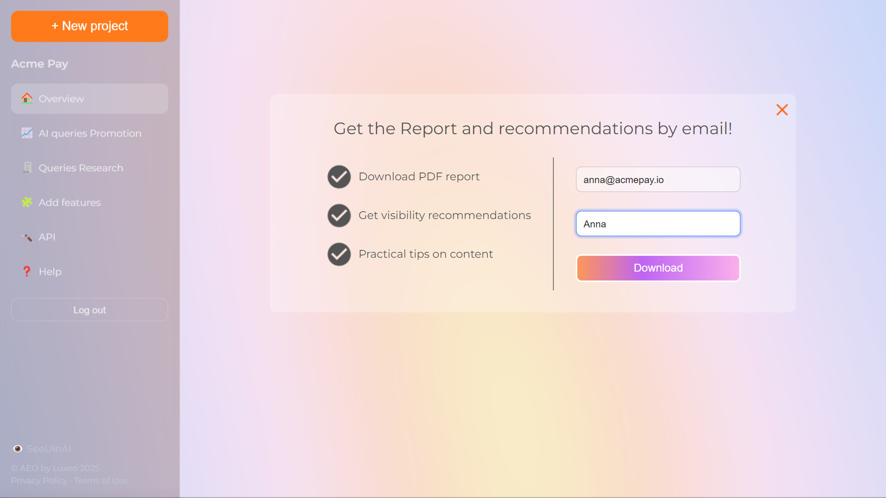<br><sub><b>8 · Report</b>: recommendations by email</sub></td>
</tr>
<tr>
<td>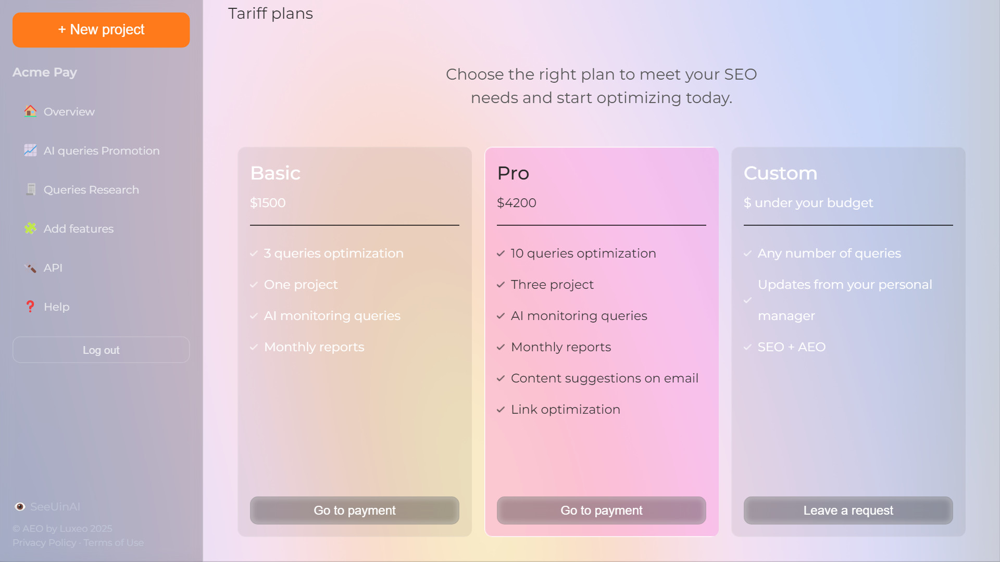<br><sub><b>9 · Plans</b>: Basic, Pro or a custom request</sub></td>
<td>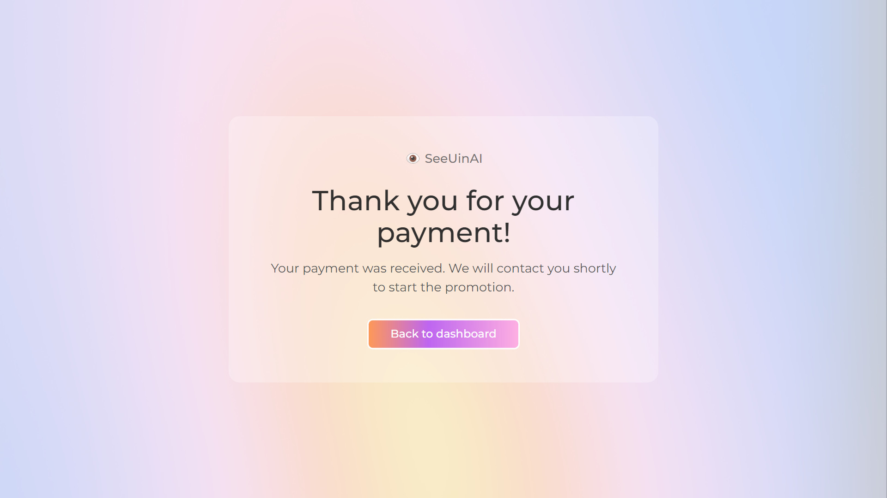<br><sub><b>10 · Payment</b>: back from Stripe Checkout</sub></td>
</tr>
</table>

## 🧭 How it works

### The user journey

A new user registers, describes the brand in a short chat, picks the queries to watch and lands on the overview. From there they can refresh the numbers, request a report or buy a plan.

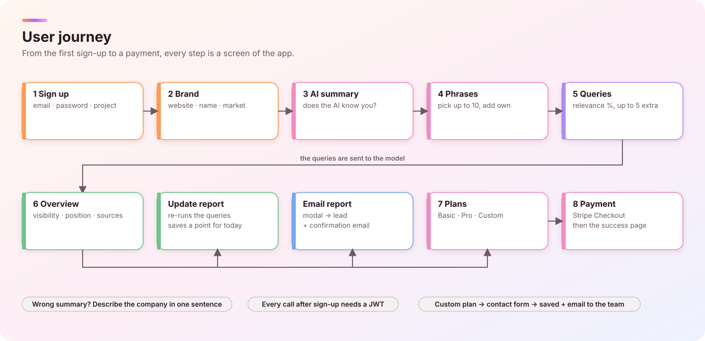

### The architecture

A React single-page app calls a FastAPI backend with a JWT. The backend asks an AI source, stores the results in PostgreSQL, takes payments through Stripe and sends emails through SendPulse. A small background worker delivers the queued emails.

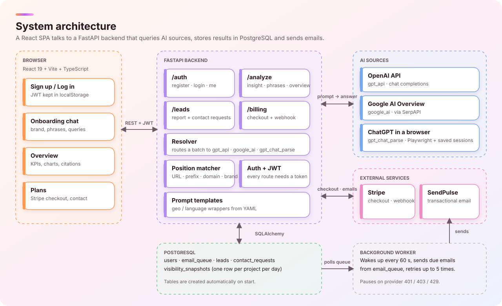

### How visibility is measured

Every query is wrapped in a prompt and sent to the model. Links are pulled out of the answer and compared with the target (your URL, domain or brand). The rank of the first match is the position. Per-project numbers are saved once a day, which gives the history on the charts.

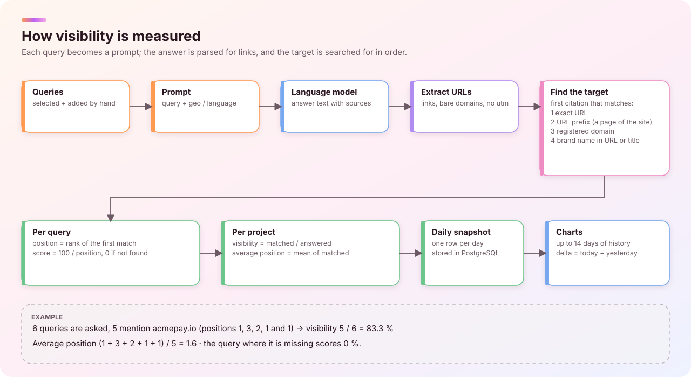

### The email funnel

Registration queues five emails. Only the report goes to everybody; reminders are sent to users who ticked the newsletter box, and the day-2 reminder only if the user logged in and has not paid.

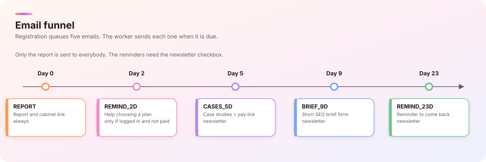

## 🚀 Quick start

You need **Python 3.12**, **Node 20+** and a running **PostgreSQL** with an empty database named `aeo`.

**1. Backend**

```bash
cd back
pip install -r requirements.txt
playwright install chromium
copy app\.env.example app\.env
python -m uvicorn app.main:app --reload
```

Fill in `app/.env` first (at least `DATABASE_URL`, `JWT_SECRET` and `OPENAI_API_KEY`). Tables are created automatically. The API is on <http://127.0.0.1:8000> and the docs are on `/docs`.

**2. Frontend**

```bash
cd aeo
npm install
npm run dev
```

Open <http://localhost:5173>. Set `VITE_API_URL` if the API is not on `127.0.0.1:8000`.

**3. Optional: ChatGPT sessions** for the `gpt_chat_parse` source

```bash
cd back
python login_chatgpt.py my-account
```

A browser opens, you log in to ChatGPT, press Enter, and the session is saved to `back/app/data/sessions/`.

## ⚙️ Configuration

| Variable | What it does |
|---|---|
| `DATABASE_URL` | PostgreSQL connection string |
| `JWT_SECRET`, `JWT_TTL_HOURS` | Signs the login tokens (the backend refuses to start without a secret) |
| `OPENAI_API_KEY`, `OPENAI_MODEL` | Model used by onboarding and the overview |
| `STRIPE_SECRET_KEY`, `STRIPE_WEBHOOK_SECRET`, `STRIPE_PRICE_BASIC`, `STRIPE_PRICE_PRO` | Payments. The webhook marks the user as paid |
| `SENDPULSE_ID`, `SENDPULSE_SECRET`, `FROM_EMAIL` | Email delivery. Without them the queue stays idle |
| `CABINET_URL`, `TELEGRAM_URL`, `PAY_URL`, `BRIEF_URL` | Links used in the emails |
| `CORS_ORIGINS`, `PUBLIC_BASE_URL` | Allowed front-end origins and the base URL for screenshots |
| `CHATGPT_HEADLESS` | `1` runs the ChatGPT browser without a window |

## 🔌 API at a glance

All routes except sign-up, login, health and the Stripe webhook need `Authorization: Bearer <token>`.

| Route | Purpose |
|---|---|
| `POST /auth/register` · `POST /auth/login` · `GET /auth/me` | Accounts and tokens |
| `POST /analyze/brand-insight` | What the model knows about the brand |
| `POST /analyze/collect-phrases` | Commercial search phrases for a company and market |
| `POST /analyze/serp` | Runs queries, returns answers, sources and relevance |
| `POST /analyze/overview` | Visibility, positions, per-query scores, history |
| `POST /leads/report-request` · `POST /leads/contact-request` | Report by email, custom-plan request |
| `POST /billing/create-checkout-session` · `POST /billing/webhook` | Stripe Checkout and its callback |
| `POST /v1/check` | Batch check with any source (`gpt_api`, `google_ai`, `gpt_chat_parse`) |
| `GET /health` | Liveness probe |

## 🗂️ Project structure

```text
.
├── aeo/                      React + Vite front end
│   └── src/
│       ├── pages/            Login, Onboarding, Overview, Plans, Success
│       ├── components/       chat steps, charts, forms
│       ├── layouts/          dashboard shell with the sidebar
│       └── lib/              API client and auth helpers
├── back/
│   ├── login_chatgpt.py      saves a ChatGPT session for Playwright
│   └── app/
│       ├── api/routes/       auth, analyze, leads, billing
│       ├── adapters/         OpenAI, Google AI, ChatGPT-in-browser
│       ├── core/             config, JWT, position matcher, mailer, worker
│       ├── models/           SQLAlchemy tables
│       └── config/           prompt and email templates
└── docs/
    ├── media/                demo video, preview GIF, subtitles
    ├── screenshots/          images used above
    └── diagrams/             SVG diagrams
```

## 🎬 About the demo

The video and screenshots use **demo data only**: the brand *Acme Pay* is fictional, the AI answers, the payment and the emails were simulated, and the chart history was seeded for the picture. Nothing was sent or charged.

## 📝 Good to know

- `gpt_api` asks a plain chat model without web search, so the "citations" are the links the model writes in its answer. For stricter results use `gpt_chat_parse` or `google_ai`.
- "Weeks to the top" is a rough estimate based on the average position, not a forecast.
- Keep `app/.env` and `app/data/sessions/` out of git. They hold secrets and login cookies.
